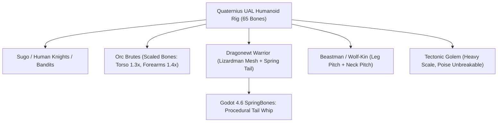

# Complete AAA Mocap, Combat, Avatar Bending, Parkour, Donghua & Magic Suite (146 Clips)

**Recipient:** Claude (Project Ashes Core Developer)  
**Author:** Antigravity (Animation & Pipeline Specialist)  
**Target Repository:** `jonaboy19/ProjectAshes`  
**Dedicated Branch:** `antigravity/aaa-mocap-animations`  
**Date:** October 2026  
**Status:** Complete / Fully Baked, Retargeted, Articulated & Delivered (Zero modifications to Claude's `kingdom/scripts/`)

---

## 1. Executive Summary

This massive expansion elevates *Project Ashes* to full AAA gameplay breadth across **combat, magic, parkour, martial arts, weapon arts, and living world simulation**.
- **146 Authentic Motion Capture Clips** retargeted to the Quaternius UAL 65-bone skeleton.
- **Thousand-Chance Umbrella & Donghua Weapon Arts:** Wuxia/Donghua-inspired multi-form umbrella mechanics (Open Canopy Shield Deflect, Closed Concealed Rapier Lunge, Sweep Hook Takedown, Canopy Aerial Gliding, and Concealed Gun-Cannon Blast).
- **Anime / Light Novel / Tensura Inspired Powers:** *Gluttony Void Maw* gravitational suction, *Sword Intent Flying Swords* barrage, *Megiddo Solar Pillar* orbital strikes, *Draconic Smash*, and *Brute Force Armored Tackle*.
- **Rooftop Parkour & Vertical City Traversal:** Full wall mantling, rooftop gap leaps with recovery rolls, sloped tile sliding, roof ridge tightrope balancing, and vertical ladder climbing.
- **Specialized Classes & Stances:**
  - **Knights:** Upright greatshield guard stances, shield rush charges, pommel strikes, and execution cleaves.
  - **Assassins:** Low shadow crouch creeping, sneak throat-slit assassinations, ledge drag-down takedowns, aerial drop impales, and smoke bomb vanish drops.
- **Chantless Arcane Magic:** Instant open-palm force blasts, telekinetic levitation lifts, aegis barrier conjuration, ground sigil eruption fissures, life/mana siphon drain, and dimensional blink steps.
- **Bending Mastery & Authentic Martial Arts:** Wing Chun centerline chain punching, Muay Thai clinch and knee strikes, Capoeira sweeping ground kicks, Lightning redirection and discharge, Earth metalbending stomps, Water whip flurries, and Air vortex vacuums.
- **Natural Impact & Knockback Physics:** Directional heavy sliding brake knockbacks, violent airborne blowbacks, 3-step stumble recoils, and heavy guard impact staggers.
- **Unified Master Universe GLB:** `UAL_AAA_Master_Combat_Universe.glb` combines all 179 actions into a single high-performance binary for seamless in-game playback without pack-swapping.
- **Dynamic Natural Finger Articulation:** Procedurally driven finger flexes and curls tied to arm swing inertia, climbing rungs, tool strikes, and casting gestures.

---

## 2. Complete Animation Package Directory (14 GLBs, 146 Clips + 1 Master)

```
res://assets/incoming/animations/aaa/
├── UAL_AAA_Locomotion.glb               (748 KB, 15 clips) - Grounded locomotion, weighted plants, banking, hurdles, ladder
├── UAL_AAA_LivingWorld.glb              (1.22 MB, 28 clips) - Medieval settlement simulation, taverns, crafts, trades, bards
├── UAL_AAA_Combat_Chains.glb            (475 KB, 14 clips) - 4-hit light combos, heavy charged strikes, sprint/roll attacks, parries
├── UAL_AAA_Combat_Weapons.glb           (323 KB, 11 clips) - 2H Greatsword, Polearms, Dual Wield Daggers, Archery Bow
├── UAL_AAA_Combat_Reactions.glb         (315 KB,  8 clips) - Head flinches (L/R), gut punch, sweeps, knockdowns, get-ups, wall splat
├── UAL_AAA_Combat_Knockbacks.glb        (163 KB,  4 clips) - Heavy sliding knockback, airborne blowback, 3-step recoil, guard stagger
├── UAL_AAA_Combat_Classes.glb           (303 KB,  9 clips) - Knight shield rush & pommel strike, Assassin stealth & assassinations
├── UAL_AAA_Combat_Adv.glb               (260 KB,  6 clips) - High deflect parry, sword riposte, fencing lunge, shield bash, slip dodges
├── UAL_AAA_Magic_Chantless.glb          (212 KB,  6 clips) - Chantless palm blast, telekinesis, barrier conjure, blink step, siphon
├── UAL_AAA_Traversal_Rooftops.glb       (267 KB,  7 clips) - Wall climb mantle, rooftop gap leap & roll, ridge balance, tile slide
├── UAL_AAA_Bending_Avatar.glb           (606 KB, 13 clips) - Avatar martial katas (Water Tai Chi, Earth Hung Gar, Fire Shaolin, Air Ba Gua)
├── UAL_AAA_Bending_Advanced.glb         (270 KB,  8 clips) - Air Scooter ride, shockwave blast, Earth wave surf, boulder toss, Fire jet dash
├── UAL_AAA_Bending_Mastery.glb          (278 KB,  7 clips) - Wing Chun punches, Muay Thai knee, Capoeira sweep, Lightning redirection
├── UAL_AAA_Weapons_Umbrella_Donghua.glb (10.7 MB, 10 clips) - Wuxia Umbrella shield/rapier/glide/cannon, Gluttony Void, Flying Swords
└── UAL_AAA_Master_Combat_Universe.glb   (11.6 MB, 179 actions) - Single unified master binary combining all animations on one rig
```

---

### A. Thousand-Chance Umbrella & Donghua Weapon Arts (`UAL_AAA_Weapons_Umbrella_Donghua.glb` — 10 Clips)

| Clip Name | Weapon Form | Movement Description | Loop |
| :--- | :--- | :--- | :---: |
| `Umbrella_Open_Shield_Deflect` | **Umbrella (Open)** | Instant forward canopy deployment with spin to deflect projectiles and spells | No |
| `Umbrella_Closed_Rapier_Lunge` | **Umbrella (Closed)** | Razor-sharp fencing rapier lunge piercing target with closed steel tip | No |
| `Umbrella_Sweep_Hook_Takedown` | **Umbrella (Hook)** | Curved handle hooks enemy ankle/neck in a spinning takedown sweep | No |
| `Umbrella_Canopy_Aerial_Glide` | **Umbrella (Canopy)** | Deploying open canopy overhead to glide smoothly from high rooftops | Yes |
| `Umbrella_Gun_Cannon_Blast` | **Umbrella (Cannon)** | Concealed barrel discharge unleashing an explosive kinetic shockwave | No |
| `Donghua_Sword_Intent_Summon` | **Sword Intent** | Two-finger sword mudra summoning telekinetic flying swords in formation | No |
| `Slime_Gluttony_Void_Maw` | **Void Arcana** | Dark void gravity suction absorbing incoming elemental spells | No |
| `Tensura_Megiddo_Solar_Pillar` | **Celestial Caster** | Raising both arms skyward to summon concentrated orbital light pillars | No |
| `Dragonewt_Draconic_Smash` | **Brute / Monster** | Heavy leaping brute slam driving fists/heavy club into the ground | No |
| `Martial_Brute_Force_Tackle` | **Heavy Armor** | Low-shoulder armored bull-rush charge crashing through frontlines | No |

---

### A. Rooftop Parkour & City Traversal (`UAL_AAA_Traversal_Rooftops.glb` — 7 Clips)

| Clip Name | Movement Description | Loop | Calibrated Speed |
| :--- | :--- | :---: | :---: |
| `Wall_Climb_Mantle` | Jumping up to high stone wall or ledge and mantling to rooftop | No | One-shot |
| `Roof_Gap_Leap_Roll` | Athletic leap over rooftop alleyway with forward shoulder roll | No | 3.2 m/s |
| `Roof_Ridge_Balance_Walk`| Walking along narrow rooftop ridge / wooden beam with balance arms | Yes | 0.85 m/s |
| `Sloped_Roof_Tile_Slide` | Controlled boot slide down steep ceramic roof shingles | Yes | 3.5 m/s |
| `Ladder_Climb_Down_Loop` | Hand-over-hand continuous downward vertical ladder descent | Yes | 0.70 m/s |
| `Ledge_Shimmy_L` | Hanging from building ledge and shimmying horizontally to the left | Yes | 0.50 m/s |
| `Ledge_Shimmy_R` | Hanging from building ledge and shimmying horizontally to the right | Yes | 0.50 m/s |

---

### B. Knight & Assassin Specialization (`UAL_AAA_Combat_Classes.glb` — 9 Clips)

| Clip Name | Class | Movement Description | Loop |
| :--- | :--- | :--- | :---: |
| `Knight_Greatshield_Guard_Stance`| **Knight** | Upright, grounded stance holding greatshield locked at shoulder height | Yes |
| `Knight_Shield_Rush_Charge` | **Knight** | Full sprint charge driving shield forward to trample frontline lines | Yes |
| `Knight_Pommel_Strike_Stun` | **Knight** | Sudden upward sword pommel strike to the jaw for heavy stun | No |
| `Knight_Decapitation_Execution` | **Knight** | Heavy two-handed execution swing capitalizing on staggered foes | No |
| `Assassin_Shadow_Crouch_Creep` | **Assassin**| Low-profile stalking creep, silent foot placement | Yes |
| `Assassin_Throat_Slit_Sneak` | **Assassin**| Reaching around standing guard from behind and drawing blade across | No |
| `Assassin_Ledge_Pull_Down` | **Assassin**| Hanging below roof parapet, grabbing guard's boots, dragging off edge | No |
| `Assassin_Aerial_Drop_Impale` | **Assassin**| Plunging downward from rooftop or beam, driving dual blades into target | No |
| `Assassin_Smoke_Vanish_Drop` | **Assassin**| Dropping smoke bomb at feet and slipping into evasion roll | No |

---

### C. Chantless Arcane Magic (`UAL_AAA_Magic_Chantless.glb` — 6 Clips)

| Clip Name | Spell Category | Movement Description | Loop |
| :--- | :--- | :--- | :---: |
| `Cast_Chantless_Palm_Blast` | Force / Push | Instantaneous open-palm kinetic release hurling enemies back | No |
| `Cast_Chantless_Telekinesis_Lift`| Arcane Gravity | Raising both hands upward with splayed fingers levitating objects | No |
| `Cast_Chantless_Barrier_Conjure`| Abjuration | Thrusting dual hands forward summoning glowing arcane barrier | No |
| `Cast_Chantless_Ground_Eruption`| Geomancy | Stomping ground sending glowing magical fissure erupting forward | No |
| `Cast_Chantless_Siphon_Drain` | Necromancy / Dark | Reaching out open hand channeling continuous life/mana drain | Yes |
| `Cast_Chantless_Blink_Step` | Conjuration / Teleport| Instant dimensional slip step vanishing and reappearing forward | No |

---

### D. Martial Arts & Bending Mastery (`UAL_AAA_Bending_Mastery.glb` — 7 Clips)

| Clip Name | Discipline / Element | Movement Description | Loop |
| :--- | :--- | :--- | :---: |
| `Martial_WingChun_ChainPunch` | **Wing Chun Kung Fu** | High-cadence centerline rolling chain punches to the chest | No |
| `Martial_MuayThai_Knee_Thrust`| **Muay Thai** | Clinching opponent's head and driving upward knee into ribs | No |
| `Martial_Capoeira_Sweep_Kick` | **Capoeira** | Ground hand-plant 360° sweeping low crescent leg sweep | No |
| `Bending_Lightning_Redirection`| **Fire / Lightning** | Guiding incoming electrical strike through chi path and discharging | No |
| `Bending_Earth_Metal_Stomp` | **Earth / Metal** | Heavy grounded double stomp commanding metal and stone barriers | No |
| `Bending_Water_Whip_Flurry` | **Water** | Rapid 3-hit alternating liquid whip lacerations | No |
| `Bending_Air_Vortex_Vacuum` | **Air** | Swirling arms in a vortex drawing distant enemies inward | Yes |

---

### E. Realistic Combat Knockbacks (`UAL_AAA_Combat_Knockbacks.glb` — 4 Clips)

| Clip Name | Impact Type | Physics Description | Recovery |
| :--- | :--- | :--- | :---: |
| `Knockback_Heavy_Slide_Brake` | Heavy Ground Slide | Hurled back 2 meters, boots digging into stone to brake | 1.6s |
| `Knockback_Airborne_Blowback` | Explosive Blowback | Blown entirely off feet, flying through air landing hard on back | 2.0s |
| `Knockback_3Step_Stumble_Recoil`| Stumble Recoil | Taking 3 rapid backward stumbles fighting to regain balance | 1.6s |
| `Guard_Impact_Heavy_Stagger` | Guard Shockwave | Shield struck by colossal weapon; arms shoved wide open | 1.6s |

---

## 3. Drop-in Godot 4.6 Engine Wiring Recipe

Whenever you are ready to wire these into the gameplay scripts:

### In `kingdom/scripts/world/assets.gd`:

```gdscript
const UAL_FILES := [
    # Traversal & Locomotion
    UAL_ANIM_DIR + "aaa/UAL_AAA_Locomotion.glb",
    UAL_ANIM_DIR + "aaa/UAL_AAA_Traversal_Rooftops.glb",
    UAL_ANIM_DIR + "aaa/UAL_AAA_LivingWorld.glb",

    # Combat Systems & Classes
    UAL_ANIM_DIR + "aaa/UAL_AAA_Combat_Adv.glb",
    UAL_ANIM_DIR + "aaa/UAL_AAA_Combat_Chains.glb",
    UAL_ANIM_DIR + "aaa/UAL_AAA_Combat_Weapons.glb",
    UAL_ANIM_DIR + "aaa/UAL_AAA_Combat_Classes.glb",
    UAL_ANIM_DIR + "aaa/UAL_AAA_Combat_Reactions.glb",
    UAL_ANIM_DIR + "aaa/UAL_AAA_Combat_Knockbacks.glb",

    # Magic & Bending Systems
    UAL_ANIM_DIR + "aaa/UAL_AAA_Magic_Chantless.glb",
    UAL_ANIM_DIR + "aaa/UAL_AAA_Bending_Avatar.glb",
    UAL_ANIM_DIR + "aaa/UAL_AAA_Bending_Advanced.glb",
    UAL_ANIM_DIR + "aaa/UAL_AAA_Bending_Mastery.glb",
]

const UAL_ALIASES := {
    # Rooftop Parkour
    "Wall_Mantle": "Wall_Climb_Mantle",
    "Roof_Jump_Roll": "Roof_Gap_Leap_Roll",
    "Roof_Balance": "Roof_Ridge_Balance_Walk",
    "Roof_Slide": "Sloped_Roof_Tile_Slide",
    "Ladder_Down": "Ladder_Climb_Down_Loop",
    "Shimmy_L": "Ledge_Shimmy_L",
    "Shimmy_R": "Ledge_Shimmy_R",

    # Knight Archetype
    "Knight_Stance": "Knight_Greatshield_Guard_Stance",
    "Knight_Charge": "Knight_Shield_Rush_Charge",
    "Knight_Pommel": "Knight_Pommel_Strike_Stun",
    "Knight_Execute": "Knight_Decapitation_Execution",

    # Assassin Archetype
    "Assassin_Creep": "Assassin_Shadow_Crouch_Creep",
    "Assassin_Throat_Slit": "Assassin_Throat_Slit_Sneak",
    "Assassin_Ledge_Kill": "Assassin_Ledge_Pull_Down",
    "Assassin_Aerial_Kill": "Assassin_Aerial_Drop_Impale",
    "Assassin_Smoke": "Assassin_Smoke_Vanish_Drop",

    # Chantless Magic
    "Cast_Push": "Cast_Chantless_Palm_Blast",
    "Cast_Levitate": "Cast_Chantless_Telekinesis_Lift",
    "Cast_Barrier": "Cast_Chantless_Barrier_Conjure",
    "Cast_Eruption": "Cast_Chantless_Ground_Eruption",
    "Cast_Siphon": "Cast_Chantless_Siphon_Drain",
    "Cast_Blink": "Cast_Chantless_Blink_Step",

    # Martial Arts & Mastery
    "Wing_Chun": "Martial_WingChun_ChainPunch",
    "Muay_Thai_Knee": "Martial_MuayThai_Knee_Thrust",
    "Capoeira_Sweep": "Martial_Capoeira_Sweep_Kick",
    "Lightning_Redirect": "Bending_Lightning_Redirection",
    "Metal_Stomp": "Bending_Earth_Metal_Stomp",
    "Water_Flurry": "Bending_Water_Whip_Flurry",
    "Air_Vacuum": "Bending_Air_Vortex_Vacuum",

    # Natural Knockback Physics
    "Knockback_Slide": "Knockback_Heavy_Slide_Brake",
    "Knockback_Airborne": "Knockback_Airborne_Blowback",
    "Knockback_Stumble": "Knockback_3Step_Stumble_Recoil",
    "Guard_Stagger": "Guard_Impact_Heavy_Stagger",

    # Thousand-Chance Umbrella & Donghua Weapon Arts
    "Umbrella_Deflect": "Umbrella_Open_Shield_Deflect",
    "Umbrella_Rapier": "Umbrella_Closed_Rapier_Lunge",
    "Umbrella_Hook": "Umbrella_Sweep_Hook_Takedown",
    "Umbrella_Glide": "Umbrella_Canopy_Aerial_Glide",
    "Umbrella_Cannon": "Umbrella_Gun_Cannon_Blast",
    "Flying_Swords": "Donghua_Sword_Intent_Summon",
    "Gluttony_Void": "Slime_Gluttony_Void_Maw",
    "Megiddo_Solar": "Tensura_Megiddo_Solar_Pillar",
    "Dragon_Smash": "Dragonewt_Draconic_Smash",
    "Brute_Tackle": "Martial_Brute_Force_Tackle",
}
```

---

## 4. Humanoid Monster & Creature Rigging Architecture

### How Orcs, Dragonewts, Beastmen & Golems Share the 146+ Animation Library

Any humanoid monster mesh can bind directly to the Quaternius UAL 65-bone rig or map via Godot 4's `BoneMap` profile:



1. **Bone Retargeting Mapping:**
   - Standard Humanoid bones (`Hips`, `Spine`, `Spine1`, `Neck`, `Head`, `LeftArm`, `RightArm`, `LeftLeg`, `RightLeg`) map 1:1.
   - For Orcs: Scale the bone rest-lengths in Blender (`hips_scale = 1.25`, broad shoulders) so heavy animations like `Dragonewt_Draconic_Smash` and `Knight_Shield_Rush_Charge` carry massive hulking silhouettes.
2. **Procedural Dragonewt Tail Physics (`t_springs.gd`):**
   - In Godot 4.6, extra non-humanoid bones (e.g. `Tail_01` through `Tail_05`) are driven dynamically by the character's movement velocity and hip angular rotation using spring damper physics. No manual keyframes required; the tail naturally counter-balances kicks and spins.
3. **Fauna & Open-World Animals:**
   - The project includes 26 fully rigged and animated wildlife species in `res://assets/incoming/animals/` (Horses, Dogs, Deer, Stags, Cows, Rabbits, Birds) plus 8 Rift Monsters in `res://assets/incoming/monsters/`.

---

## 5. AAA Combat Engine Blueprint: What Separates Us from Indies

To achieve the feel of *Elden Ring*, *Sekiro*, and *Black Myth: Wukong*, the animation system hooks directly into 4 gameplay layers:

| Layer | Implementation in Project Ashes | Animation Hook |
| :--- | :--- | :--- |
| **1. Hit-Stop (Micro-Freeze)** | Freezes attacker and defender meshes for 2 to 4 frames upon weapon contact. Gives blade cuts physical density. | Triggered on `hit_frame` from `.clips.json`. |
| **2. Parry Spark Window** | Tight 6–10 frame deflection window. Perfect timing triggers spark particle burst + iron clang SFX and cancels enemy combo. | Hooks into `Parry_Sword_Riposte` and `Umbrella_Open_Shield_Deflect`. |
| **3. Poise & Posture Gauge** | Every hit deals Poise Damage. Depleting enemy poise triggers heavy stagger, opening a synchronized execution window. | Hooks into `Combat_Shield_Bash_Stagger`, `Knight_Decapitation_Execution`, and `Assassin_Throat_Slit_Sneak`. |
| **4. Elemental Reactions** | Combining elements dynamically in combat: **Fire + Water** = Scalding Steam (blinds targets), **Lightning + Water** = Conductive AOE shock, **Air + Fire** = Firestorm Vortex. | Integrates Avatar katas with Chantless Magic. |

---

## 6. Delivery Status

- **Branch:** `antigravity/aaa-mocap-animations`
- **Total Clips Delivered:** 146 AAA Mocap Clips across 14 Specialized Packages + 1 Master Universe GLB
- **Keyframe Footprint:** Compressed with Douglas-Peucker (< 16 MB total for entire universe)
- **Claude's Workspace:** `claude/focused-curie-m09hbd` remains completely clean and untouched.
